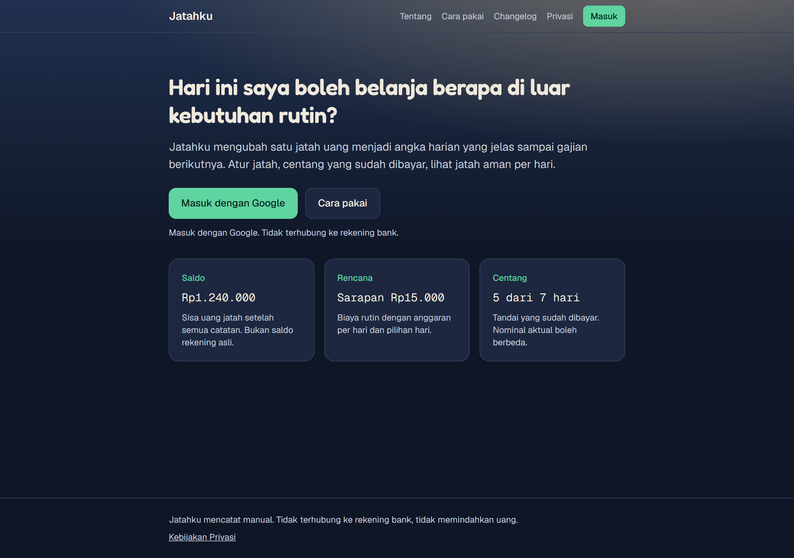
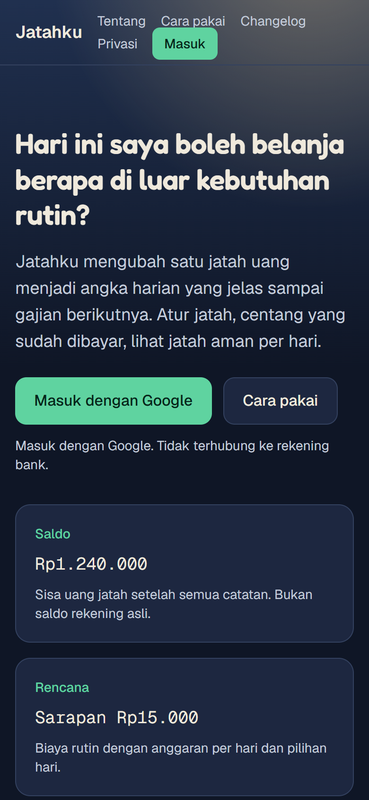
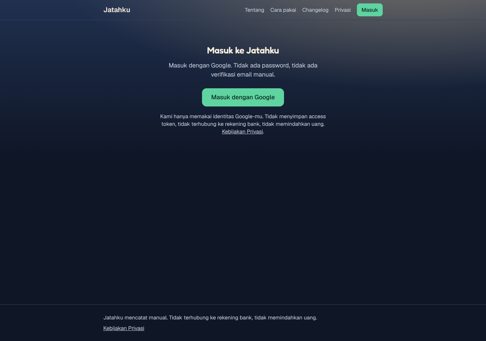
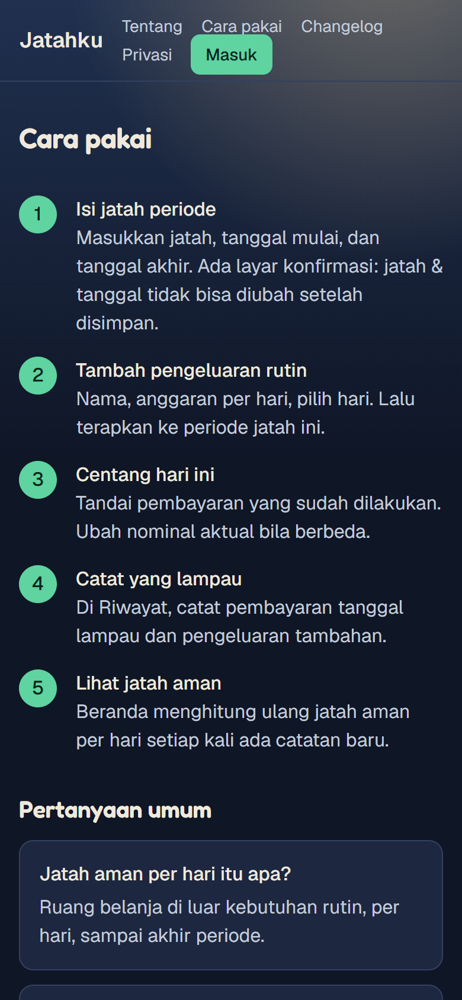

# Jatahku 🐦‍⬛

**Jatahku** mengubah satu jatah uang per periode menjadi angka harian yang jelas sampai gajian berikutnya: atur jatah, daftarkan biaya rutin yang dihitung per hari, centang yang sudah dibayar, dan lihat jatah aman untuk hari ini.

**Coba langsung:** [jatahku-mu.vercel.app](https://jatahku-mu.vercel.app) · login pakai akun Google.

| Desktop | Mobile |
| --- | --- |
|  |  |

| Halaman masuk | Cara pakai (mobile) |
| --- | --- |
|  |  |

## Fitur

- **Jatah per periode** — satu angka awal, dipecah menjadi jatah harian sampai akhir periode.
- **Biaya rutin + centang harian** — rencana pengeluaran per hari dengan pilihan hari; nominal aktual boleh beda dari rencana.
- **Pengeluaran ekstra** — catatan belanja di luar kebutuhan rutin.
- **Riwayat** — ringkasan catatan per periode.
- **Login Google** — OAuth, tanpa pernah menyentuh rekening bank; semua catatan manual.
- **Tema terang & gelap**, dirancang mobile-first.

## Teknologi

- [Next.js](https://nextjs.org) (App Router) + TypeScript
- [Prisma](https://www.prisma.io) + PostgreSQL (Neon)
- Tailwind CSS
- Auth: Google OAuth (implementasi ringan di `src/app/api/auth/google`)
- Host: [Vercel](https://vercel.com) · DB: [Neon](https://neon.tech)

## Menjalankan lokal

```bash
npm install
cp .env.example .env          # isi DATABASE_URL, AUTH_SECRET, kredensial Google
npx prisma migrate dev        # siapkan database lokal
npm run db:seed               # data contoh (opsional)
npm run dev
```

Buka [http://localhost:3000](http://localhost:3000). Mode `dev` punya login mock di `/masuk/mock` (otomatis nonaktif di produksi).

## Deploy

Panduan lengkap (Vercel + Neon + env produksi + OAuth Google): lihat [DEPLOY.md](DEPLOY.md).

## Untuk agen AI

[AGENTS.md](AGENTS.md) berisi aturan kontribusi untuk coding agent (struktur, larangan, konvensi). Rilis v1.x mengikuti spesifikasi bertahap di dokumen tersebut.

---

Jatahku mencatat manual. Tidak terhubung ke rekening bank, tidak memindahkan uang.
